<div align="center">



</div>

<br/>

<!-- 01 ABOUT -->

I'm **Ketan**, a 2nd year B.Tech CSE (AI/ML) student at Lovely Professional University. I like turning ideas into things people can actually open in a browser: I design them, code them, and write the pitch for them too. Right now I'm building my fundamentals in **C++ and DSA**, going deeper into **AI**, and shipping full stack projects along the way.

<table>
<tr>
<td width="50%" valign="top">

**What I'm up to right now**

- Building and improving **STAI**, my AI-powered study app (it's live!)
- Practicing **C++** and **DSA** to get sharper at problem solving
- Making my first **open source contributions**
- Doing freelance web work for local businesses and NGOs

</td>
<td width="50%" valign="top">

**Ask me about**

- Building and deploying a full stack app (Vercel + Render)
- Getting started with freelance web development
- Starting out in open source as a first or second year
- Pitching a website to a small business or NGO

</td>
</tr>
</table>

<br/>

<!-- 02 NOW LEARNING -->

<br/>

<!-- 03 STAI -->

<div align="center">

<a href="https://frontend-rho-rosy-98.vercel.app"></a>
<a href="https://github.com/dev-ketan-1603/STAI"></a>

</div>

<br/>

<!-- 04 STACK -->

<table>
<tr>
<td width="22%"><b>Languages</b></td>
<td></td>
<td width="22%"><b>Status</b></td>
<td>C++ is the one I'm leveling up</td>
</tr>
<tr>
<td><b>Frontend</b></td>
<td></td>
<td><b>Status</b></td>
<td>React in use, Next.js up next</td>
</tr>
<tr>
<td><b>Backend + DB</b></td>
<td></td>
<td><b>Status</b></td>
<td>Working through the full MERN path</td>
</tr>
<tr>
<td><b>Tools</b></td>
<td></td>
<td><b>Hosting</b></td>
<td>Vercel (frontend) + Render (backend)</td>
</tr>
</table>

<br/>

<!-- 05 PROJECTS -->

<table>
<tr>
<td width="50%"></td>
<td width="50%"></td>
</tr>
<tr>
<td width="50%"></td>
<td width="50%"></td>
</tr>
</table>

<br/>

<!-- 06 JOURNEY -->

<br/>

<!-- 07 OPEN SOURCE -->

<!-- Replace the placeholder row with your real contributions. Add one row per PR. -->

| Project | What I changed | PR |
|---|---|---|
| _add your first repo_ | _what you fixed or added_ | _link to your PR_ |

<br/>

<!-- 08 GAME -->

Read the code, decide your answer, then click **Reveal** to check. Keep your own score and compare it with the ranks above.

<table>
<tr>
<td width="50%" valign="top">

<details>
<summary><b>ROUND 1</b> · integer vs float division</summary>

```cpp
int a = 7;
cout << a / 2 << " " << a % 2 << " " << a / 2.0;
```

<details>
<summary>Reveal answer</summary>

**`3 1 3.5`**

`a / 2` is integer division, `a % 2` is the remainder, and dividing by `2.0` promotes the result to double.

</details>
</details>

</td>
<td width="50%" valign="top">

<details>
<summary><b>ROUND 2</b> · the sizeof trick</summary>

```cpp
int arr[] = {4, 8, 15};
cout << sizeof(arr) / sizeof(arr[0]);
```

<details>
<summary>Reveal answer</summary>

**`3`**

Total bytes of the array divided by the bytes of one element gives the element count. It only works on a real array, not on a pointer.

</details>
</details>

</td>
</tr>
<tr>
<td width="50%" valign="top">

<details>
<summary><b>ROUND 3</b> · vector surprise</summary>

```cpp
vector<int> v = {1, 2, 3};
v.push_back(v.size());
cout << v.back();
```

<details>
<summary>Reveal answer</summary>

**`3`**

`v.size()` is evaluated first and gives 3, and that value is then pushed to the back.

</details>
</details>

</td>
<td width="50%" valign="top">

<details>
<summary><b>ROUND 4</b> · char math</summary>

```cpp
string s = "DSA";
s += 'x' + 1;
cout << s;
```

<details>
<summary>Reveal answer</summary>

**`DSAy`**

`'x' + 1` becomes the int 121, which converts to the char `'y'` and gets appended.

</details>
</details>

</td>
</tr>
</table>

<details>
<summary><b>BOSS ROUND</b> · chained comparison</summary>

```cpp
cout << (5 > 3 > 1);
```

<details>
<summary>Reveal answer</summary>

**`0`**

C++ has no chained comparisons. `5 > 3` is evaluated first and gives `1` (true), then `1 > 1` is false, which prints `0`.

</details>
</details>

Got a tricky snippet that would stump me? [Open an issue](https://github.com/dev-ketan-1603/dev-ketan-1603/issues/new) and challenge me.

<br/>

<!-- 09 STATS -->

<table>
<tr>
<td width="50%" align="center">

</td>
<td width="50%" align="center">

</td>
</tr>
<tr>
<td colspan="2" align="center">

</td>
</tr>
<tr>
<td colspan="2" align="center">

</td>
</tr>
</table>

<div align="center">

<picture>
  <source media="(prefers-color-scheme: dark)" srcset="https://raw.githubusercontent.com/dev-ketan-1603/dev-ketan-1603/output/github-snake-dark.svg" />
  <source media="(prefers-color-scheme: light)" srcset="https://raw.githubusercontent.com/dev-ketan-1603/dev-ketan-1603/output/github-snake.svg" />
  
</picture>

</div>

<br/>

<!-- 10 GOALS -->

<br/>

<!-- 11 CONNECT -->

<div align="center">

<a href="https://github.com/dev-ketan-1603"></a>
<!-- Add yours below and remove the comment markers:
<a href="https://www.linkedin.com/in/YOUR-ID"></a>
<a href="mailto:you@example.com"></a>
-->

<br/><br/>


</div>
